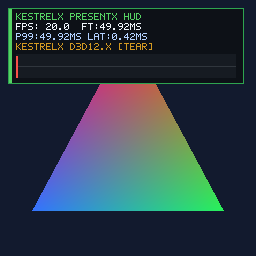
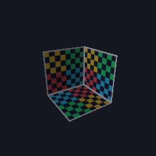
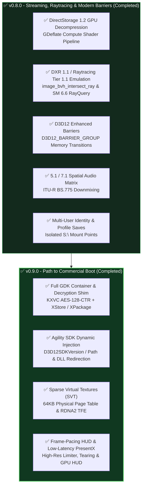
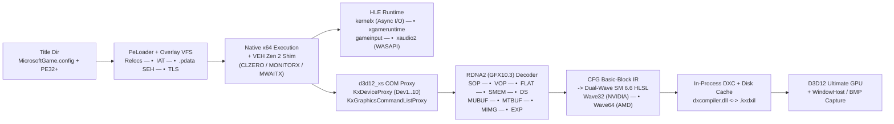

<div align="center">

  <h1>KestrelX</h1>

  <p><strong>Clean-Room Xbox Series X|S Native Compatibility &amp; Dynamic RDNA2 (GFX10.3) &rarr; SM 6.6 DXIL Shader Recompilation Runtime</strong></p>

  <p>
    <a href="#milestone-timeline"></a>
    <a href="#verified-hardware-test-receipts"></a>
    <a href="#external-amd-rga-gfx1030-validation"></a>
    <a href="#hardware-visual-showcase"></a>
    <a href="CMakeLists.txt"></a>
    <a href="docs/ARCHITECTURE.md"></a>
    <a href="LICENSE"></a>
    <a href="https://discord.gg/KxsNwBwhVs"></a>
  </p>

  <p><em>Built from scratch in C++23 under the MIT license &mdash; zero proprietary code, zero game assets, zero cryptographic keys.</em></p>

  <p>
    <a href="#hardware-visual-showcase">Visual Showcase</a> &bull;
    <a href="#live-progress-dashboard">Progress Dashboard</a> &bull;
    <a href="#architecture">Architecture</a> &bull;
    <a href="#verified-hardware-test-receipts">Hardware Receipts</a> &bull;
    <a href="#building--running">Build &amp; Run</a> &bull;
    <a href="https://discord.gg/KxsNwBwhVs">Discord</a> &bull;
    <a href="#contributing">Contribute</a>
  </p>

</div>

---

## Hardware Visual Showcase

Every image below is captured directly from real **D3D12 Ultimate** hardware after KestrelX dynamically decodes raw **GFX10.3 (RDNA2)** microcode, lifts it into CFG basic-block IR, emits SM 6.6 HLSL, compiles signed DXIL in-process via `dxcompiler.dll`, and renders on both **NVIDIA GeForce RTX 4060** and **AMD Radeon 780M**:

<table>
  <tr>
    <td align="center" colspan="2">
      <br/>
      <b>v0.9.0 &mdash; PresentX Low-Latency Telemetry HUD &amp; Frame Pacing</b><br/>
      <sub>Live GPU-composited 5&times;7 telemetry overlay (<code>FPS / FT / P99 / Present Latency / Sparkline</code>),<br/>
      waitable flip-model swapchain (<code>DXGI_PRESENT_ALLOW_TEARING</code>), high-res frame limiter &amp; borderless fullscreen</sub>
    </td>
  </tr>
  <tr>
    <td align="center" width="50%">
      <br/>
      <b>v0.5.0 — 3D Depth-Buffered Perspective Cube</b><br/>
      <sub>Raw RDNA2 <code>D32_FLOAT</code> Depth-Stencil, Dynamic Descriptors & Wave Intrinsics<br/>
      Dual-GPU rasterization parity: <b>7222 vs 7224 px (&lt;0.03%)</b></sub>
    </td>
    <td align="center" width="50%">
      <br/>
      <b>v0.6.0 — PBR Deferred GBuffer (3-MRT Pipeline)</b><br/>
      <sub>Simultaneous multi-target rasterization: <b>[MRT0: Albedo | MRT1: Normal | MRT2: Material]</b><br/>
      Dual-GPU cross-vendor rendering parity: <b>0/255 bit-exact</b></sub>
    </td>
  </tr>
  <tr>
    <td align="center" width="50%">
      <br/>
      <b>v0.3.0 — Visual First Light</b><br/>
      <sub>Raw RDNA2 <code>EXP pos0/param0/mrt0</code> via <code>KxDeviceProxy</code></sub>
    </td>
    <td align="center" width="50%">
      <br/>
      <b>v0.4.0 — Textured Quad</b><br/>
      <sub>Raw RDNA2 <code>MUBUF</code> Vertex + <code>MIMG</code> Pixel Shader (bit-exact)</sub>
    </td>
  </tr>
</table>

---

## Live Progress Dashboard

### Milestone Timeline

```mermaid
flowchart LR
    M1["✅ v0.1.0<br/>PE32+ Loader, VFS,<br/>VEH Zen 2, RDNA2 CS"]
    M2["✅ v0.2.0<br/>SMEM + LDS + Barrier,<br/>D3D12.X PSO Proxy, BCn"]
    M3["✅ v0.3.0<br/>Visual First Light (VS/PS),<br/>WindowHost, GameInput, XA2"]
    M4["✅ v0.4.0<br/>MUBUF/MTBUF + MIMG Quad,<br/>Disk DXIL Cache, Dev1..10, WASAPI"]
    M5["✅ v0.5.0<br/>Wave Intrinsics, 3D Depth Cube,<br/>Dynamic Descriptors, DirectStorage"]
    M6["✅ v0.6.0<br/>2D Compute Tiling, PBR MRT,<br/>Async Compute, Force Feedback"]
    M7["✅ v0.7.0<br/>Mesh Shaders, VRS Tier 2,<br/>Work Graphs, IR Optimizer"]
    M8["✅ v0.8.0<br/>GPU DirectStorage 1.2,<br/>DXR 1.1 / BVH, 7.1 Audio, Saves"]
    M9["✅ v0.9.0<br/>KXVC AES-128-CTR + XStore,<br/>Agility SDK, SVT 64KB, PresentX HUD"]
    M10["✅ v0.10.0<br/>External AMD RGA gfx1030<br/>ELF64 + GFX10.3 Spec Audit"]
    M11["✅ v0.11.0<br/>Unmodified DirectX 12 &amp;<br/>Xbox GDK EXE Execution"]
    M12["✅ v0.12.0 (Current)<br/>ID3D12Device10 Proxy,<br/>xgameruntime.dll &amp; GDK Mesh"]
    M13["🚀 v1.0.0 (Horizon)<br/>Commercial Title Bring-Up<br/>&amp; Live GPU Profiler"]

    M1 --> M2 --> M3 --> M4 --> M5 --> M6 --> M7 --> M8 --> M9 --> M10 --> M11 --> M12 --> M13

    style M1 fill:#1f6f3b,stroke:#2ea44f,color:#fff
    style M2 fill:#1f6f3b,stroke:#2ea44f,color:#fff
    style M3 fill:#1f6f3b,stroke:#2ea44f,color:#fff
    style M4 fill:#1f6f3b,stroke:#2ea44f,color:#fff
    style M5 fill:#1f6f3b,stroke:#2ea44f,color:#fff
    style M6 fill:#1f6f3b,stroke:#2ea44f,color:#fff
    style M7 fill:#1f6f3b,stroke:#2ea44f,color:#fff
    style M8 fill:#1f6f3b,stroke:#2ea44f,color:#fff
    style M9 fill:#1f6f3b,stroke:#2ea44f,color:#fff
    style M10 fill:#1f6f3b,stroke:#2ea44f,color:#fff
    style M11 fill:#1f6f3b,stroke:#2ea44f,color:#fff
    style M12 fill:#107c10,stroke:#56d364,stroke-width:3px,color:#fff
    style M13 fill:#1f3a5f,stroke:#58a6ff,color:#fff
```



### RDNA2 IR Multi-Pass Optimization Pipeline

```mermaid
flowchart LR
    A["Raw GFX10.3 Microcode<br/>(SALU, VALU, EXP, MUBUF)"] --> B["CFG Lifter<br/>Basic Blocks & Registers"]
    B --> C["Pass 1: Unreachable Pruning<br/>BFS Dead-Block Elimination"]
    C --> D["Pass 2: Copy Propagation<br/>SMov/VMov Register Inlining"]
    D --> E["Pass 3: Constant Folding<br/>Arithmetic & Identity Reduction"]
    E --> F["Pass 4: Backward DCE<br/>Liveness Analysis & Dead Flags"]
    F --> G["SM 6.6 HLSL Generator<br/>Wave32 (NVIDIA) / Wave64 (AMD)"]
    G --> H["In-Process DXC<br/>dxcompiler.dll"]
    H --> I["Persistent Disk Cache<br/>LRU Quota (.kxdxil)"]

    style A fill:#161b22,stroke:#30363d,color:#c9d1d9
    style B fill:#161b22,stroke:#30363d,color:#c9d1d9
    style C fill:#1f6f3b,stroke:#2ea44f,color:#fff
    style D fill:#1f6f3b,stroke:#2ea44f,color:#fff
    style E fill:#1f6f3b,stroke:#2ea44f,color:#fff
    style F fill:#1f6f3b,stroke:#2ea44f,color:#fff
    style G fill:#00599c,stroke:#1f6feb,color:#fff
    style H fill:#107c10,stroke:#56d364,color:#fff
    style I fill:#0078d6,stroke:#58a6ff,color:#fff
```



### Subsystem Verification Matrix

| Subsystem | Status | Implemented & Verified (`v0.12.0`) | Next Horizon (`v1.0.0`) |
| :--- | :---: | :--- | :--- |
| **PE32+ Loader & System Libs** | ✅ Verified | `MicrosoftGame.config` XML, PE32+ relocs (DIR64/HIGHLOW), delay-load imports (RVA/legacy VA), export forwarders (DLL.Symbol, DLL.#Ordinal), multi-page thunk cleanup, `.pdata` SEH, TLS callbacks, GDK Agility SDK query (`D3D12SDKVersion`, `D3D12SDKPath`), dynamic DLL redirection, `pe-probe` import auditor | Side-by-side title updates & patch mounts |
| **CPU VEH Zen 2 Shim** | ✅ Verified | In-process VEH emulator for AMD Zen 2 `CLZERO`, `MONITORX`, `MWAITX`, `MCOMMIT`, `RDPRU`, `PREFETCHW`, and SSE4a `EXTRQ`/`INSERTQ` for Intel CPU compatibility | Dynamic TSC virtualization & CPU core topology pinning |
| **Copy-on-Write Overlay VFS** | ✅ Verified | Case-insensitive per-layer path cache, merged `list_directory` across base and overlay, whiteout suppression, non-throwing `std::error_code` safety, multi-user `S:\` save isolation, Xbox drive prefixes (`GAME:\`, `G:\`, `D:\`, `C:\`, `S:\`, `T:\`) | Encrypted container archive streaming mounts |
| **RDNA2 -> IR -> SM 6.6 DXIL** | ✅ Verified | External AMD RGA `gfx1030` ELF64 (`AMDHSA` ABI + MsgPack metadata) support, 12/12 real `gfx1030` kernels (`412/412` instructions, `0` unsupported) verified on hardware, VOP3A/B/VOP3-VOPC, SMEM `x8`/`x16`, divergent SIMT `exec` loops (`v_cmpx_*`, `s_andn2_saveexec_b32`), IEEE `v_frexp`/`v_ldexp`/`v_cmp_class_f32`, Mesh (`ms_6_6`) & Amplification (`as_6_6`), VRS Tier 2, BVH `RayQuery`, Wave intrinsics, `MIMG` `TFE` PRT | Inline procedural primitive intersection & full retail shader opcode tail |
| **RDNA2 IR Optimization Passes** | ✅ Verified | Unreachable basic-block pruning, intra-block copy propagation, constant folding (integer & float operations), backward liveness DCE & unused flag pruning, dual-GPU parity | Inter-block global value numbering (GVN) |
| **Persistent DXIL Shader Cache** | ✅ Verified | Mutex-protected thread-safe `DiskShaderCache`, LRU size quotas (`max_entries`, `max_bytes`), multi-dimensional dispatch keys (`group_y`, `group_z`, `mrt_mask`), corruption eviction | Background async shader pre-compilation pool |
| **D3D12.X COM Proxy (`d3d12_xs`)** | ✅ Verified | Full `ID3D12Device10` COM inheritance `KxDeviceProxy` (zero proxy bypass across `Device1..10`), `CreateCommandList1` / `CreateCommandQueue1` / `CreateCommittedResource1..3` wrapping, stream PSO auto-recomp, Async Compute queues with timeline fence sync, Work Graph DAG & 2-node `ExecuteIndirect`, `ID3D12GraphicsCommandList6/7` Enhanced Barriers & `DispatchMesh`, `d3d12.dll`/`d3d12core.dll` HLE redirection, SVT (`CreateReservedResource`, `UpdateTileMappings`, `CopyTiles`) | DirectSR super-resolution bridge |
| **WindowHost & PresentX** | ✅ Verified | Win32 `WindowHost` + `IDXGISwapChain3` waitable flip-model (`--windowed`, `DXGI_PRESENT_ALLOW_TEARING`), `FramePacer` (`CREATE_WAITABLE_TIMER_HIGH_RESOLUTION`, P99 telemetry, `--fps`, `--tearing`), borderless fullscreen (`--fullscreen`, `Alt+Enter`), live 236×76 GPU-composited telemetry HUD (`--hud`), headless BMP capture (`--capture`) | Multi-monitor HDR10 scRGB tone-mapping |
| **Input (`gameinput.dll`)** | ✅ Verified | COM `GameInputCreate`, multi-controller slot management (0..3), hotplug callbacks & telemetry, impulse trigger force-feedback + dual-motor rumble bridging | Virtual gamepad remapping & deadzone calibration |
| **Audio (`xaudio2_9.dll`)** | ✅ Verified | COM `XAudio2Create`, multi-voice software mixer, submix bus routing, non-48kHz pitch resampling, X3DAudio 3D spatial positioning, ITU-R BS.775 5.1 & 7.1 surround downmixing matrix, WASAPI thread lifecycle | WASAPI exclusive mode stream sync |
| **KernelX & GDK HLE** | ✅ Verified | `XMemAlloc`/`Free`/`Size`, `TitleMemoryStatus`, `CreateFileA/W/2`, `ReadFileEx`, `XTaskQueue*`, DirectStorage 1.2 GDeflate GPU streaming, multi-user identity profiles, isolated `S:\` save partitions, clean-room `KXVC` AES-128-CTR / pass-through containers, `XStoreAcquireLicense*`, `XPackageMountWithUiAsync` VFS decryption | Cloud save sync stubbing |
| **GFX10 Texture Tiling** | ✅ Verified | Clean-room 2D swizzle/deswizzle (all 7 modes), BC1/BC7 4×4 block tiling, 256B-aligned multi-level mip-chains, SGD5 archive decompression, 64KB SVT virtual texture layout & LRU physical tile pool | 3D/Array volume tiling & live upload staging |

---

### What's New in v0.12.0

KestrelX v0.12.0 upgrades the D3D12.X COM proxy to full **`ID3D12Device10` inheritance**, ships a **standalone drop-in `xgameruntime.dll` clean-room shim**, and verifies an **unmodified D3D12 Ultimate Mesh Shader Xbox GDK executable** (`ms_6_5`/`ps_6_5` + `DirectXTK12` SpriteFont HUD) end-to-end with 100% proxy telemetry:
* **Full `ID3D12Device1..10` COM Proxy Inheritance (`include/kestrel/hle/d3d12x.hpp`, `src/hle/d3d12x.cpp`)**: Upgraded `KxDeviceProxy` from `ID3D12Device2` to `ID3D12Device10`, eliminating COM proxy bypass when modern titles (`ID3D12Device8`+) call `QueryInterface`. Wraps `CreateCommandList1`, `CreateCommandQueue1`, `CreateCommittedResource1/2/3`, `CreatePlacedResource1/2`, and `CreateReservedResource1/2`, with SDK-portable `CreateCommittedResource3` / `CreatePlacedResource2` / `CreateReservedResource2` castable-format signature deduction across Windows SDK `10.0.22621` and `10.0.26100`.
* **Standalone Drop-In `xgameruntime.dll` Shim (`src/shims/xgameruntime_dll.cpp`, `src/shims/xgameruntime.def`)**: New CMake target `kestrel_xgameruntime_shim` builds `build/Release/shims/xgameruntime.dll`, exporting the full GDK dynamic thunk ABI (`InitializeApiImpl*`, `UninitializeApiImpl`, `QueryApiImpl`, `XError*`, `XGameRuntime*`, `XUser*`, `XStore*`, `XPackage*`, `XTaskQueue*`, `GameInputCreate`) backed directly by KestrelX's clean-room HLE runtime.
* **CLI Mesh Shader Telemetry (`src/cli/main.cpp`)**: `kestrel run` now reports `mesh=<N>` (`DispatchMesh` calls intercepted through `KxGraphicsCommandListProxy`) alongside `draws`, `barriers`, `res`, `q`, `cmd`, and `present`.
* **Verified Unmodified D3D12 Ultimate GDK Mesh Shader Binary (Compiled Locally Outside Repo)**:
  * **`microsoft/Xbox-GDK-Samples` (`SimpleMeshShader.exe`, MIT, SM 6.5 `ms_6_5`/`ps_6_5` + `ID3D12Device8` + `ID3D12GraphicsCommandList6` + `DirectXTK12` SpriteFont HUD)**: `pe-probe` `218/218` imports (`100.0%`), ran 5 frames cleanly under `kestrel run --max-frames 5 --capture`, exit code `0`, full proxy telemetry `dev=1, q=1, cmd=2, res=10, draws=5, mesh=5, barriers=13, present=5`, 1280×720 RGB backbuffer verified.
* **New Regression Tests (`Tests 74–75`)**: `KxDeviceProxy` full `ID3D12Device1..10` COM identity & `CreateCommandList1`/`CreateCommittedResource2/3` wrapping (`Test 74`), and live `LoadLibraryW` verification of standalone `shims/xgameruntime.dll` (`Test 75`).

### What's New in v0.11.0

KestrelX v0.11.0 brings up **unmodified, full-CRT (`/MD`, `wWinMainCRTStartup`) third-party Win32, DirectX 12, and Microsoft Xbox GDK `.exe` binaries** end-to-end on real GPU hardware:
* **Authentic `ntdll`-Managed Static TLS Slot (`src/loader/tls_slot_dll.cpp`, `src/loader/pe_loader.cpp`)**: Provisions a genuine 64 KB static TLS slot via `kestrel_tls_slot.dll` without mutating `TEB->ThreadLocalStoragePointer` (`gs:[0x58]`), preserving host GPU driver TLS safety and propagating guest TLS automatically to worker threads created via `CreateThread`.
* **Guest Process Identity, Exit Isolation & SEH Crash Diagnostics (`src/loader/pe_loader.cpp`)**: Dedicated 4 MB guest execution thread with `kernel32.dll` / `ucrtbase.dll` host overlays (`GetModuleHandle*`, `GetModuleFileName*`, `GetCommandLine*`, `LoadLibrary*`, `GetProcAddress`, `GetFileAttributes*`, `ExitProcess`/`exit`/`_crt_atexit`, console drive `CreateFile*`), plus C-style SEH crash telemetry (exception code, `module+RVA`, register dump, RIP bytes, called stubs) and env-gated `KESTREL_TRACE_HLE=1` loader tracing.
* **DXGI / SwapChain Proxy & Standard D3D12/DXGI Ordinal Exports (`src/hle/d3d12x.cpp`)**: `KxDxgiFactoryProxy` (`IDXGIFactory6`) + `KxSwapChainProxy` (`IDXGISwapChain4`) count `Present()` calls, capture live GPU backbuffers to BMP (`--capture`), cleanly close guest windows at `--max-frames <N>`, and resolve standard Windows D3D12/DXGI ordinal imports (`d3d12.dll` `#101`/`#110`/`#115`, `dxgi.dll` `#10`/`#11`/`#12`).
* **Official Microsoft GDK `xgameruntime.lib` Dynamic Thunk ABI (`src/hle/xgameruntime.cpp`)**: Exports `InitializeApiImpl`, `InitializeApiImplEx`, `InitializeApiImplEx2`, `UninitializeApiImpl`, `QueryApiImpl`, `XErrorReport`, `XErrorSetCallback`, `XErrorSetOptions`, `XGameRuntimeInitializeWithOptions`, and `XGameRuntimeIsFeatureAvailable` alongside virtual HLE DLL `GetFileAttributesW` probing — enabling unmodified Microsoft Xbox GDK titles to initialize and run cleanly without Microsoft Gaming Services or host `xgameruntime.dll` installed.
* **Verified Unmodified Third-Party MIT Binaries (Compiled Locally Outside Repo)**:
  * **`microsoft/DirectX-Graphics-Samples` (`D3D12HelloTriangle.exe`, MIT)**: `pe-probe` `85/85` imports (`100.0%`), executed unmodified via `kestrel run --max-frames 5 --capture`, exit code `0`, `present=5`, `draws=5`, 1280×720 RGB backbuffer captured.
  * **`microsoft/Xbox-GDK-Samples` (`SimpleTriangleDesktop.exe`, MIT, linked against public Microsoft GDK `v2610.0.9661` `xgameruntime.lib` + `DirectXTK12`)**: `pe-probe` `180/180` imports (`100.0%`), dynamically loaded KestrelX's clean-room `xgameruntime.dll` thunk (`InitializeApiImplEx2` / `XErrorReport` / `UninitializeApiImpl`), rendered `5` frames (`draws=5`, `present=5`), exited with code `0`, 1280×720 RGB backbuffer captured.
* **New Regression Tests (`Tests 71–73`)**: Full-CRT static TLS + worker TLS + `ExitProcess` isolation (`Test 71`), full-CRT Win32 + D3D12 `KxSwapChainProxy` `--max-frames 3` + 256×256 BMP pixel verification (`Test 72`), and official GDK `xgameruntime.lib` dynamic thunk ABI verification (`Test 73`).

### What's New in v0.10.0

KestrelX v0.10.0 adds **external compiler binary validation**, **ELF64-AMDGPU (`AMDHSA`) parsing**, and an **AMD GFX10.3 ISA spec decoder audit**:
* **External AMD RGA (`gfx1030`) ELF64 Kernel Validation (`tests/amd_kernels/`)**: 12 standalone OpenCL compute kernels (`k01_vec_add` through `k12_morton_2d`) compiled independently with **AMD Radeon GPU Analyzer (`rga -s opencl -c gfx1030`)** into real `ELF64-AMDGPU` (`amdgcn-amd-amdhsa--gfx1030`) machine code (`412` total RDNA2 instructions). KestrelX parses the ELF64 `.text` + `.AMDGPU.config` + MsgPack `.note` descriptors, lifts `412/412` instructions with `0` unsupported opcodes, recompiles to SM 6.6 DXIL, and executes all `12/12` across `NVIDIA RTX 4060` + `AMD Radeon 780M` (`36` GPU dispatches; `10/12` integer/bitwise/control-flow/FMA/LDS/matrix kernels bit-exact `u32`, `2/12` hardware `v_rcp_f32`/`v_rsq_f32` transcendental kernels within tight IEEE tolerance against independent C++ CPU references).
* **GFX10.3 ISA Spec Decoder Audit & Strict Refusal (`Test 69`)**: Verifies exact machine-code bitfields across `SOP1/2/K/C/P`, `SMEM`, `VOP1/2/C/3A/3B`, `FLAT/GLOBAL`, and `DS` (including divergent `exec` loops `v_cmpx_*`/`s_andn2_saveexec_b32`, `s_mul_i32` opcode `38`, `v_mul_f32` opcode `8`, `v_cmp_*_f32` `0x00..0x0F`, `v_perm_b32`, `v_mad_u64_u32`, `v_frexp_*`/`v_ldexp_f32`, `v_cmp_class_f32`, `s_load_dwordx8/x16`, and Wave64 `vcc_lo`/`vcc_hi` + `exec_lo`/`exec_hi` propagation) and asserts strict `#error` refusal on unknown opcodes and `SCRATCH` segment encodings.
* **AMDGPU ELF64 Support in `kestrel shader-census`**: `shader-census` natively unpacks `.elf` / `.hsaco` / `.co` / `.o` ELF64-AMDGPU objects alongside `SGD5` archives, RPF-embedded `SGD5`, `DXBC`, and raw RDNA2 binaries.

### What's New in v0.9.0

KestrelX v0.9.0 completes the full v0.8.0 & v0.9.0 roadmap across graphics, GDK security/streaming, and low-latency presentation:
* **RDNA2 Mesh (`ms_6_6`) & Amplification (`as_6_6`) Shaders**: Full support for console primitive export, dynamic vertex output counts, and workgroup amplification pipelines compiled cleanly via SM 6.6 DXIL.
* **Variable Rate Shading (VRS Tier 2)**: Dynamic 16×16 and 8×8 tile rate-image decoders, combiners, and `ID3D12GraphicsCommandList5::RSSetShadingRateImage` proxy support.
* **D3D12 Work Graphs**: DAG validation, 16-byte aligned `RecordRingAllocator`, and dual-GPU verified 2-node `ExecuteIndirect` producer->consumer pipeline.
* **RDNA2 IR Optimization Passes**: 4 deterministic optimization passes (unreachable block pruning, copy propagation, constant folding, and backward liveness dead-code elimination) yielding reduced HLSL size while preserving bit-exact dual-GPU output.
* **Persistent Disk Shader Cache LRU Quota**: Thread-safe caching with entry and byte-limit LRU evictions and multi-dimensional dispatch key support.
* **Overlay VFS Case-Insensitive Cache & Directory Enumeration**: Per-layer cache eliminating redundant disk iterations, merged `list_directory` with whiteout masking, and non-throwing `std::error_code` safety.
* **Expanded RDNA2 Instruction Set**: Full 30-predicate VCmp/SCmp coverage, 64-bit scalar moves/inversions, bitfield manipulation (`v_bfe_u32`, `v_bfi_b32`), and global 4-dword memory transactions.
* **Audio & Input Hardening**: Multi-voice XAudio2 mixer with submix routing, pitch resampling, X3DAudio spatialization, and 4-slot GameInput multi-controller hotplugging.
* **GDK Agility SDK Query & Dynamic DLL Redirection**: Discovers guest exports `D3D12SDKVersion` and `D3D12SDKPath`, automatically mounts packaged SDK directories to search paths, and transparently redirects guest imports for `d3d12.dll` and `d3d12core.dll` to KestrelX HLE shims (`kx_D3D12GetInterface`, `D3D12CreateDevice`).
* **Sparse Virtual Texturing (SVT) & Feedback Maps**: 64KB physical page table (`VirtualTexturePageTable`) with LRU eviction, `SvtFeedbackAnalyzer` (RGBA8 residency & min-mip feedback maps), RDNA2 `MIMG` `TFE=1` (`CheckAccessFullyMapped`) lifting, and real D3D12 `CreateReservedResource` + `UpdateTileMappings` + `CopyTiles` telemetry.
* **GDK Cryptographic Container (`KXVC`) & License Decryption Shim**: Clean-room `GdkContentContainer` supporting transparent unencrypted pass-through (`GdkCipherMode::None`) and seekable Win32 CNG AES-128-CTR stream decryption (`GdkCipherMode::Aes128Ctr`) with CRC32 segment verification, `GdkKeyRing` SHA-256 token key derivation, and full `xgameruntime.dll` HLE shims (`XGameRuntimeInitialize`, `XStoreAcquireLicenseForPackageAsync`/`Durables`/`CanAcquireLicense`/`QueryAddOnLicenses`, `XPackageMountWithUiAsync` -> `OverlayVfs`).
* **PresentX Frame Pacing, Waitable Flip-Model & Low-Latency HUD**: High-resolution `FramePacer` (`CREATE_WAITABLE_TIMER_HIGH_RESOLUTION`, P99 & sliding-window telemetry), `IDXGISwapChain3` waitable frame latency + `DXGI_PRESENT_ALLOW_TEARING` (`--tearing`), borderless fullscreen (`--fullscreen` / `Alt+Enter`), and a crisp 236×76 5×7 GPU-composited telemetry HUD (`--hud`, `--fps <N>`).
* **Batch Shader Census & PE32+ Compatibility Probe (`shader-census` / `pe-probe`)**: Offline CLI tools to batch-unpack/decode/recompile `SGD5`, RPF-embedded `SGD5`, `DXBC`, and raw RDNA2 shaders (with unsupported-opcode histograms and `--json` export) and audit any PE32+ binary's Agility SDK exports, relocations, `.pdata`/TLS, and HLE import coverage.
* **Dual-GPU Verification Expanded to 68/68 PASS**: Every feature tested bit-exact across physical NVIDIA RTX 4060 and AMD Radeon 780M hardware, plus `--unit-only` mode (53 passed, 15 skipped) and GitHub Actions CI.

---

### Roadmap Status & Completed Milestones



#### ✅ v0.8.0 — Streaming, Raytracing & Modern Barriers (Completed)
1. **DirectStorage 1.2 GPU Decompression**: In-shader GDeflate decompression pipeline offloading asset decompression directly to host GPUs.
2. **DXR 1.1 / Raytracing Tier 1.1 Emulation**: RDNA2 `image_bvh_intersect_ray` decode, IR lift, and SM 6.6 `RayQuery` DXIL emission.
3. **D3D12 Enhanced Barriers (`D3D12_BARRIER_GROUP`)**: Modern `ID3D12GraphicsCommandList7::Barrier` proxy & group tracking.
4. **Spatial Audio 5.1 / 7.1 Downmixing**: ITU-R BS.775 surround matrix mixer & WASAPI stereo bridge.
5. **Multi-User Identity & Profile Saves**: Profile-isolated `S:\` save mounts and controller-to-XUID binding.

#### ✅ v0.9.0 — Path to Commercial Boot (Completed)
1. **Full GDK Cryptographic & License Decryption Shim**: Clean-room `KXVC` AES-128-CTR / pass-through containers, `GdkKeyRing`, `XStoreAcquireLicense*`, and `XPackageMountWithUiAsync` -> `OverlayVfs`.
2. **DirectX 12 Agility SDK Runtime Dynamic Injection**: Guest export discovery (`D3D12SDKVersion`, `D3D12SDKPath`) and `d3d12.dll`/`d3d12core.dll` HLE redirection.
3. **Sparse Virtual Texturing (SVT) & Feedback Maps**: 64KB physical page table LRU remapping, RGBA8/Min-Mip feedback, RDNA2 `MIMG` `TFE=1` (`CheckAccessFullyMapped`), and D3D12 `CreateReservedResource`.
4. **Frame Pacing & PresentX Low-Latency HUD**: Waitable flip-model tear-free sync, `CREATE_WAITABLE_TIMER_HIGH_RESOLUTION` frame limiter, borderless fullscreen toggle, and GPU-composited 236×76 performance HUD.

> **Scope & Verification Note (`v0.12.0`):** KestrelX passes **75/75 tests** across physical NVIDIA RTX 4060 and AMD Radeon 780M GPUs (and **58/58** in `--unit-only` CI with **0 MSVC `/W4 /permissive-` warnings**), including **12/12 externally compiled AMD RGA `gfx1030` ELF64 kernels**, a clean-room Xbox-ABI guest test title (`kestrel_test_title.exe`), and verified unmodified MIT DirectX 12 & Xbox GDK desktop samples (`D3D12HelloTriangle.exe`, `SimpleTriangleDesktop.exe`, `SimpleMeshShader.exe`) built outside this repository. Booting unmodified commercial retail Xbox Series X|S titles remains future `v1.0.0` work (requiring per-title shader/HLE surface coverage and retail assets outside this clean-room repository).

---

### External AMD RGA (`gfx1030`) Validation

To avoid testing the recompiler solely on hand-crafted synthetic shader arrays, [`tests/amd_kernels/`](tests/amd_kernels/) provides 12 OpenCL kernels compiled independently by **AMD Radeon GPU Analyzer (`rga.exe -s opencl -c gfx1030`)** into standard `ELF64-AMDGPU` (`AMDHSA`) binaries:

```text
$ .\build\Release\kestrel.exe shader-census tests\amd_kernels
KestrelX Shader Census Report
  Target        : tests\amd_kernels
  Wave Mode     : Wave32 (DXC=active)
  Files / SGD5  : 12 file(s), 0 SGD5 archive(s)
  Total Entries : 12 (unpacked=12, unpack_err=0, pre_dxil=0)
  RDNA2 Decoded : 12 / 12 (100.0%)
  IR Clean      : 12 / 12 (100.0%)
  HLSL Emitted  : 12 / 12 (100.0%)
  DXIL Compiled : 12 / 12 (100.0%, 51788 bytes total)
  Instructions  : 412 total, 0 unsupported (100.00% supported)
  Stage Breakdown:
    Compute       : total=12, decoded=12, ir_clean=12, hlsl=12, dxil=12
```

Every kernel is then executed end-to-end on real D3D12 Ultimate hardware (`Test 70`) and compared against an independent C++ CPU reference implementation:
* **10/12 bit-exact (`u32`)** across all 64 threads / 2 workgroups (`k01_vec_add`, `k02_saxpy`, `k03_hash_u32`, `k04_dot4_f32`, `k06_select_i32`, `k07_loop_collatz`, `k08_bitfield`, `k10_lds_reverse`, `k11_mat4_mul`, `k12_morton_2d`).
* **2/12 within tight IEEE tolerance** (`k05_clamp_smooth` using `v_frexp_*`/`v_rcp_f32`/`v_ldexp_f32 clamp`, `k09_math_f32` using `native_sqrt`/`native_rsqrt`/`native_recip` + `v_cmp_class_f32`).

## Architecture



### Why KestrelX? (Architectural Differentiation)

| Subsystem | KestrelX Design | Why It Matters |
| :--- | :--- | :--- |
| **D3D12.X (`d3d12_xs.dll`)** | **Pure COM Wrapper Proxies (`KxDeviceProxy`, `KxCommandQueueProxy`, `KxGraphicsCommandListProxy`)** | Zero in-place driver vtable patching — safe across NVIDIA, AMD, Intel, and Wine/vkd3d-proton drivers. |
| **Shader Pipeline** | **RDNA2 (GFX10.3) -> CFG Basic-Block IR -> Dual Wave32 & Wave64 SM 6.6 HLSL -> In-Process DXC + Persistent Disk Cache** | Compiles native Wave32 shaders for NVIDIA warps and native Wave64 shaders for AMD RDNA GPUs from the same structured IR, verified bit-exact on dual-GPU hardware. |
| **CPU Execution** | **Native PE32+ x64 Loader + VEH Zen 2 Shim** | Runs x86-64 natively with full relocations, guest DLL chaining, TLS callbacks, `.pdata` SEH, and VEH emulation for AMD Zen 2 instructions so Intel CPUs do not trap with `0xC000001D`. |
| **Filesystem** | **Copy-on-Write Overlay VFS** | Maps `GAME:\`, `G:\`, `D:\`, `S:\`, and `T:\` with whiteouts and path-traversal rejection. The source title directory is **never mutated**. |
| **Verification** | **75 Self-Contained Hardware & Unit Tests + Clean-Room Guest Titles** | Links against 5 synthetic console import libs (`kernelx`, `xgameruntime`, `d3d12_xs`, `gameinput`, `xaudio2_9`) and validates every layer on real GPUs with zero retail files. |

---

## Verified Hardware Test Receipts

Tested on Windows 11 x64 (`MSVC 19.44 /W4 /permissive-` with **0 warnings**, Windows 11 SDK `10.0.26100.0`, dual D3D12 Ultimate GPUs — **NVIDIA GeForce RTX 4060 Laptop GPU** + **AMD Radeon 780M**):

```text
KestrelX Verification Suite
===========================
  [PASS] MicrosoftGame.config XML parser
  [PASS] Overlay VFS copy-on-write, whiteouts & path-traversal rejection
  [PASS] VEH AMD Zen 2 instruction decoder & emulator (CLZERO/MONITORX/MWAITX)
  [PASS] RDNA2 (GFX10.3) decoder, CFG IR lifter & dual Wave32/Wave64 HLSL emission
  [PASS] In-process DXC SM 6.6 compilation & DXBC/DXIL container verification
    -> Hardware verified: [0] NVIDIA GeForce RTX 4060 Laptop GPU | Wave32 | DXIL=4116 B | both CFG branches bit-exact
    -> Hardware verified: [1] AMD Radeon(TM) 780M | Wave32 | DXIL=4116 B | both CFG branches bit-exact
    -> Hardware verified: [1] AMD Radeon(TM) 780M | Wave64 | DXIL=4116 B | both CFG branches bit-exact
    -> Hardware verified: [2] NVIDIA GeForce RTX 4060 Laptop GPU | Wave32 | DXIL=4116 B | both CFG branches bit-exact
  [PASS] End-to-end RDNA2 -> IR -> HLSL -> DXC -> Real Dual-GPU Hardware Execution
    -> Hardware verified LDS+SMEM: [0] NVIDIA GeForce RTX 4060 Laptop GPU | Wave32 | 64/64 reversed+added bit-exact
    -> Hardware verified LDS+SMEM: [1] AMD Radeon(TM) 780M | Wave32 | 64/64 reversed+added bit-exact
    -> Hardware verified LDS+SMEM: [1] AMD Radeon(TM) 780M | Wave64 | 64/64 reversed+added bit-exact
    -> Hardware verified LDS+SMEM: [2] NVIDIA GeForce RTX 4060 Laptop GPU | Wave32 | 64/64 reversed+added bit-exact
  [PASS] RDNA2 SMEM + DS (LDS) + s_barrier Workgroup Shuffle on Dual-GPU Hardware
  [PASS] RDNA2 EXP Vertex & Pixel (vs_6_6 / ps_6_6) Decode, IR Lift & DXC Compile
    -> Textured Quad verified: [0] NVIDIA GeForce RTX 4060 Laptop GPU | MUBUF VS + MIMG PS | 256x256 4-quadrant checkerboard | max_delta=0/255
    -> Textured Quad verified: [1] AMD Radeon(TM) 780M | MUBUF VS + MIMG PS | 256x256 4-quadrant checkerboard | max_delta=0/255
    -> Textured Quad verified: [2] NVIDIA GeForce RTX 4060 Laptop GPU | MUBUF VS + MIMG PS | 256x256 4-quadrant checkerboard | max_delta=0/255
  [PASS] RDNA2 MUBUF/MTBUF + MIMG (image_sample) Textured Quad on Dual-GPU Hardware
  [PASS] Strict recompiler refusal of unsupported RDNA2 opcodes
  [PASS] Persistent on-disk DXIL shader cache & corruption recovery
  [PASS] D3D12.X ID3D12Device1..10 QI, Stream PSO Recomp & CmdListProxy Telemetry
  [PASS] GFX10 2D texture swizzle/deswizzle round-trip (all 7 modes)
  [PASS] GFX10 BC1/BC7 block-compressed tiling & 5-level mip-chain layout
  [PASS] GameInput -> XInput/Win32 controller bridge & mock verification
  [PASS] XAudio2 stereo PCM ring-buffer, RMS energy & underrun verification
  [PASS] KernelX CreateFile2/ReadFileEx Async VFS I/O & WASAPI Thread Lifecycle
    -> Guest title PASS: HLE_imports=22, GuestDLL_imports=2, TLS=1, D3D12X(dev=1, q=1, res=2, draws=1, barriers=2, cs_pso=1, gfx_pso=2, cache_hit=3, present=1), GI(reads=1), XA2(frames=64)
  [PASS] End-to-end PE32+ Loader + Guest DLL + Wide-VFS + GameInput + XAudio2 + RDNA2 VS/PS First Light
    -> Hardware [0] NVIDIA GeForce RTX 4060 Laptop GPU PASS (Wave Intrinsics bit-exact across 32 lanes)
    -> Hardware [1] AMD Radeon(TM) 780M PASS (Wave Intrinsics bit-exact across 32 lanes)
    -> Hardware [2] NVIDIA GeForce RTX 4060 Laptop GPU PASS (Wave Intrinsics bit-exact across 32 lanes)
  [PASS] RDNA2 Wave Intrinsics (WaveReadLaneFirst/At, WavePrefixCountBits, Ballot) on Dual-GPU Hardware
  [PASS] RDNA2 Multi-Texture & Multi-Buffer Dynamic Descriptor Remapping
    -> Hardware [0] NVIDIA GeForce RTX 4060 Laptop GPU PASS (3D Perspective Cube: 7222 lit pixels, DSV D32_FLOAT verified)
    -> Hardware [1] AMD Radeon(TM) 780M PASS (3D Perspective Cube: 7224 lit pixels, DSV D32_FLOAT verified)
    -> Hardware [2] NVIDIA GeForce RTX 4060 Laptop GPU PASS (3D Perspective Cube: 7222 lit pixels, DSV D32_FLOAT verified)
  [PASS] RDNA2 Depth-Buffered 3D Lit & Textured Perspective Cube on Dual-GPU Hardware
  [PASS] GDK XUser/XStore/XPackage & DirectStorage VFS Async Bridge
    -> Hardware [0] NVIDIA GeForce RTX 4060 Laptop GPU PASS (2D Workgroup 16x16 Tiling bit-exact across 256 threads)
    -> Hardware [1] AMD Radeon(TM) 780M PASS (2D Workgroup 16x16 Tiling bit-exact across 256 threads)
    -> Hardware [2] NVIDIA GeForce RTX 4060 Laptop GPU PASS (2D Workgroup 16x16 Tiling bit-exact across 256 threads)
  [PASS] RDNA2 2D/3D Compute Workgroup Tiling & LDS Spatial Exchange on Dual-GPU Hardware
    -> Hardware [0] NVIDIA GeForce RTX 4060 Laptop GPU PASS (PBR Deferred GBuffer 3-MRT bit-exact)
    -> Hardware [1] AMD Radeon(TM) 780M PASS (PBR Deferred GBuffer 3-MRT bit-exact)
    -> Hardware [2] NVIDIA GeForce RTX 4060 Laptop GPU PASS (PBR Deferred GBuffer 3-MRT bit-exact)
  [PASS] RDNA2 PBR Material Deferred GBuffer (Albedo, Normal, Material) MRT Pipeline on Dual-GPU Hardware
  [PASS] D3D12.X Async Compute Queue & Inter-Queue Fence Synchronization
  [PASS] GameInput Dual-Motor & Trigger Force Feedback Rumble Bridge
  [PASS] Spatial Audio 5.1 & 7.1 Multi-Channel Surround Downmix Matrix (ITU-R BS.775)
  [PASS] GDK Multi-User Profile Identity, Controller Binding & Isolated S:\ Saves
  [PASS] RDNA2 Hardware Raytracing BVH (IMAGE_BVH_INTERSECT_RAY) Decode, IR Lift & SM 6.6 RayQuery DXIL
  [PASS] GDK Agility SDK Query, Dynamic DLL Redirection & Modern D3D12/D3D12Core HLE Export Shims
  [PASS] Sparse Virtual Texturing (SVT) 64KB Page Table, LRU Eviction, Feedback & RDNA2 TFE
  [PASS] Sparse Virtual Texturing (SVT) Reserved Resource, TFE Feedback & LRU Remap on Dual-GPU Hardware
  [PASS] GDK Cryptographic Container (KXVC AES-128-CTR / Pass-Through) & XStore/XPackage License Decryption
  [PASS] PresentX Frame Pacer (125 FPS Limiter, P99 Telemetry) & 5x7 HUD Rasterizer
    -> Hardware [0] NVIDIA GeForce RTX 4060 Laptop GPU PASS (PresentX 236x76 Telemetry HUD composited bit-exact)
    -> Hardware [1] AMD Radeon(TM) 780M PASS (PresentX 236x76 Telemetry HUD composited bit-exact)
    -> Hardware [2] NVIDIA GeForce RTX 4060 Laptop GPU PASS (PresentX 236x76 Telemetry HUD composited bit-exact)
  [PASS] PresentX Low-Latency Telemetry HUD GPU Compositor on Dual-GPU Hardware
    -> Shader Census: 5/5 SGD5 unpacked, 4/5 DXIL compiled, histogram pinned vop1_99
  [PASS] Batch RDNA2 Shader Census (SGD5 Archive + DXC DXIL + Unsupported Opcode Histogram)
    -> PE Probe: 32/32 imports resolved on test_title + Agility v614 & missing API audit PASS
  [PASS] PE32+ Compatibility Probe (HLE, Guest DLL, Host & Agility SDK Import Audit)
  [PASS] AMD GFX10.3 (RDNA2) ISA Spec Decoder Audit & Strict Refusal
    -> External AMD RGA gfx1030 ELF64 Suite: 12/12 kernels verified across 3 hardware GPU(s) (36 dispatches, 10/12 bit-exact u32)
  [PASS] External AMD RGA gfx1030 ELF64 Kernels (12 Real Kernels) on Dual-GPU Hardware
  [PASS] Full-CRT Win32 EXE Runtime (Static TLS, Worker Thread TLS, Process Identity, Dynamic LoadLibrary & ExitProcess Isolation)
    -> Full-CRT D3D12 EXE PASS: presents=3, BMP=256x256, center RGB=(25,204,76)
  [PASS] Full-CRT Win32 + D3D12 + KxDxgiFactoryProxy/KxSwapChainProxy Render, --max-frames & BMP Capture
  [PASS] GDK xgameruntime.lib Dynamic Thunk ABI (InitializeApiImplEx2, QueryApiImpl, XErrorReport & HLE Probe)
    -> KxDeviceProxy ID3D12Device8/10 PASS: dev10=yes, q=1, cmd=1, res=2, qi_upgrades=2
  [PASS] D3D12.X KxDeviceProxy Full ID3D12Device1..10 COM Identity & CreateCommandList1/Resource2/3 Wrapping
  [PASS] Standalone Drop-In xgameruntime.dll Shim DLL Live LoadLibrary & GDK ABI Execution
Summary: 75 passed, 0 failed
```

Unmodified third-party MIT `.exe` execution receipts (compiled locally from official Microsoft sources outside the repository; zero proprietary assets committed):
```text
# 1. microsoft/DirectX-Graphics-Samples (MIT) — D3D12HelloTriangle.exe (unmodified)
$ .\build\Release\kestrel.exe pe-probe D3D12HelloTriangle.exe
  Import Audit  : 85 / 85 resolved (100.0% | HLE=3, Guest=0, Host=82, Missing/Stub=0)
$ .\build\Release\kestrel.exe run D3D12HelloTriangle.exe --max-frames 5 --capture ms_hello_triangle.bmp
Loaded D3D12HelloTriangle.exe @ 0x0000000140000000 (relocs=0, hle_imports=13, guest_imports=0, host_imports=72, stubs=0)
Guest exited with code 0 | D3D12.X(dev=1, q=1, cmd=1, res=1, draws=5, barriers=10, cs_pso=0, gfx_pso=0, cache_hit=0, disk_hit=0, present=5)

# 2. microsoft/Xbox-GDK-Samples (MIT) — SimpleTriangleDesktop.exe (unmodified, public GDK v2610.0.9661 xgameruntime.lib + DirectXTK12, no host xgameruntime.dll)
$ .\build\Release\kestrel.exe pe-probe SimpleTriangleDesktop.exe
  Import Audit  : 180 / 180 resolved (100.0% | HLE=3, Guest=0, Host=177, Missing/Stub=0)
$ .\build\Release\kestrel.exe run SimpleTriangleDesktop.exe --max-frames 5 --capture gdk_triangle.bmp
Loaded SimpleTriangleDesktop.exe @ 0x0000000140000000 (relocs=0, hle_imports=17, guest_imports=0, host_imports=163, stubs=0)
Guest exited with code 0 | D3D12.X(dev=1, q=1, cmd=1, res=2, draws=5, mesh=0, barriers=10, cs_pso=0, gfx_pso=0, cache_hit=0, disk_hit=0, present=5)

# 3. microsoft/Xbox-GDK-Samples (MIT) — SimpleMeshShader.exe (unmodified, SM 6.5 ms_6_5/ps_6_5 + ID3D12Device8 + ID3D12GraphicsCommandList6 + DirectXTK12 SpriteFont)
$ .\build\Release\kestrel.exe pe-probe SimpleMeshShader.exe
  Import Audit  : 218 / 218 resolved (100.0% | HLE=3, Guest=0, Host=215, Missing/Stub=0)
$ .\build\Release\kestrel.exe run SimpleMeshShader.exe --max-frames 5 --capture gdk_mesh_shader.bmp
Loaded SimpleMeshShader.exe @ 0x0000000140000000 (relocs=0, hle_imports=17, guest_imports=0, host_imports=201, stubs=0)
Guest exited with code 0 | D3D12.X(dev=1, q=1, cmd=2, res=10, draws=5, mesh=5, barriers=13, cs_pso=0, gfx_pso=0, cache_hit=0, disk_hit=0, present=5)
```

CLI cold vs warm persistent disk-cache verification:
```text
# Cold run (compiles CS + VS + PS via DXC & writes .kxdxil to disk):
$ .\build\Release\kestrel.exe run build\Release\test_title --cache-dir %TEMP%\kx_cache
Loaded kestrel_test_title.exe @ 0x0000000140000000 (relocs=0, hle_imports=22, guest_imports=2, host_imports=8, stubs=0)
Guest exited with code 0 | D3D12.X(dev=1, q=1, cmd=1, res=2, draws=1, barriers=2, cs_pso=1, gfx_pso=2, cache_hit=3, disk_hit=0, present=1) | KernelX(allocs=1, peak=4096 B, async_rd=0) | GameInput(reads=1) | XAudio2(frames=64)

# Warm run (0 DXC compiles — all 3 shaders restored instantaneously from disk cache):
$ .\build\Release\kestrel.exe run build\Release\test_title --cache-dir %TEMP%\kx_cache
Loaded kestrel_test_title.exe @ 0x0000000140000000 (relocs=0, hle_imports=22, guest_imports=2, host_imports=8, stubs=0)
Guest exited with code 0 | D3D12.X(dev=1, q=1, cmd=1, res=2, draws=1, barriers=2, cs_pso=0, gfx_pso=0, cache_hit=6, disk_hit=3, present=1) | KernelX(allocs=1, peak=4096 B, async_rd=0) | GameInput(reads=1) | XAudio2(frames=64)
```

---

## Building & Running

### Requirements
- Windows 10/11 x64
- Visual Studio 2022 (or Build Tools) with C++ x64 toolset + CMake + Ninja
- Windows 11 SDK (`10.0.22621.0` or newer, includes `d3d12.h`, `dxcapi.h`, `dxcompiler.dll`)
- Any D3D12 Feature Level 12.0+ GPU (SM 6.6 recommended for shader tests)

### One-Command Build & Test
```powershell
powershell -ExecutionPolicy Bypass -File scripts/build.ps1 -Config Release
```

### CLI Usage
```powershell
# List D3D12 adapters and Wave32/Wave64 capabilities
.\build\Release\kestrel.exe adapters

# Inspect a title directory (MicrosoftGame.config + PE32+ imports)
.\build\Release\kestrel.exe inspect build\Release\test_title

# Audit PE32+ import resolution against KestrelX HLE + Agility SDK + guest/host DLLs (optional --json)
.\build\Release\kestrel.exe pe-probe build\Release\test_title --json pe_probe.json

# Batch-decode & recompile SGD5 / RPF-embedded SGD5 / DXBC / raw RDNA2 shaders (optional --wave 64, --no-dxc, --limit N, --json)
.\build\Release\kestrel.exe shader-census path\to\shaders.sgd --wave 32 --json shader_census.json

# Disassemble raw RDNA2 (GFX10.3) microcode
.\build\Release\kestrel.exe disasm path\to\shader.bin

# Run RDNA2 -> IR -> HLSL -> DXC -> GPU hardware self-test on all adapters
.\build\Release\kestrel.exe selftest

# Run the clean-room guest test title (headless BMP capture, live DXGI window, WASAPI audio, custom DXIL disk cache)
.\build\Release\kestrel.exe run build\Release\test_title --capture first_light.bmp
.\build\Release\kestrel.exe run build\Release\test_title --hud --fps 120 --tearing --capture presentx_hud.bmp
.\build\Release\kestrel.exe run build\Release\test_title --windowed --fullscreen --hud --fps 120 --audio --cache-dir .\shader_cache
```

---

## Repository Layout

```text
include/kestrel/
  common/    # Result<T>, hex/UTF-8 helpers
  loader/    # MicrosoftGame.config parser, PE32+ parser, native PeLoader, PeProbe compatibility auditor
  cpu/       # VEH AMD Zen 2 instruction decoder & emulator
  vfs/       # Copy-on-Write Overlay VFS with whiteouts
  hle/       # HLE registry + stub thunks, kernelx (async I/O), xgameruntime, d3d12x (Dev1..10 + CmdListProxy), WindowHost, GameInput, XAudio2 (WASAPI)
  gpu/       # RDNA2 ISA decoder (SOP/VOP/FLAT/SMEM/DS/MUBUF/MTBUF/MIMG/EXP), AMDGPU ELF64 parser, DXBC parser, CFG IR, multi-stage HLSL recompiler, ShaderCensus, DiskShaderCache, DXC, GPU runner, GFX10 tiling
src/         # Corresponding C++23 implementations + CLI (src/cli/main.cpp) + standalone drop-in shims (src/shims/xgameruntime_dll.cpp)
tests/       # 75-test unit/dual-GPU verification runner + 12 external AMD RGA gfx1030 ELF64 kernels + full-CRT D3D12 & Xbox-ABI clean-room test titles
docs/        # Architecture documentation & hardware-captured renders (first_light.png, textured_quad.png)
```

---

## Contributing

Contributions are warmly welcome! Join our official **[Discord Community](https://discord.gg/KxsNwBwhVs)** to discuss architecture, shader compilation, and collaborate in real-time. Every subsystem is modular and backed by fast, self-contained tests that run without any proprietary game files. See [CONTRIBUTING.md](CONTRIBUTING.md) and [docs/ARCHITECTURE.md](docs/ARCHITECTURE.md), join the [Welcome Discussion](https://github.com/Batushn/KestrelX/discussions/9), or pick up one of the open [`good first issue`](https://github.com/Batushn/KestrelX/issues?q=is%3Aissue+is%3Aopen+label%3A%22good+first+issue%22) tasks.

## Legal & Clean-Room Policy

KestrelX is an independent, clean-room open-source interoperability project licensed under the [MIT License](LICENSE). This repository contains **zero** copyrighted game files, **zero** proprietary SDK headers or libraries, **zero** decryption keys, and **zero** code derived from Microsoft or third-party proprietary software. Do not submit pull requests or issues containing copyrighted assets, keys, retail logs, or pirated material.
