# KestrelX

[](LICENSE)
[](CMakeLists.txt)
[](scripts/build.ps1)
[](docs/ARCHITECTURE.md)
[](CONTRIBUTING.md)

**Clean-Room Xbox Series X|S Native Compatibility & Dynamic RDNA2 Shader Recompilation Runtime (C++23 / Windows x64 / D3D12 Ultimate)**

KestrelX is an open-source, clean-room Windows x64 compatibility layer and dynamic RDNA2 (GFX10.3) → SM 6.6 DXIL shader recompilation runtime for Xbox Series X|S titles. Built from scratch in modern C++23 under the MIT license with zero proprietary code, zero game assets, and zero cryptographic keys.

```mermaid
flowchart LR
    A["Title Dir<br/>MicrosoftGame.config + PE32+"] --> B["PeLoader + Overlay VFS<br/>Relocs · IAT · .pdata SEH · TLS"]
    B --> C["Native x64 Execution<br/>+ VEH Zen 2 Shim<br/>(CLZERO/MONITORX/MWAITX)"]
    C --> D["HLE Runtime<br/>kernelx · xgameruntime<br/>d3d12_xs KxDeviceProxy"]
    D --> E["RDNA2 (GFX10.3) Decoder<br/>→ CFG Basic-Block IR"]
    E --> F["Dual-Wave SM 6.6 HLSL<br/>Wave32 (NVIDIA) · Wave64 (AMD)"]
    F --> G["In-Process DXC<br/>dxcompiler.dll → Signed DXIL"]
    G --> H["D3D12 Ultimate GPU"]
```



---

## Why KestrelX? (Architectural Differentiation)

Instead of patching driver internals in-place or translating GPU instructions with flat macro dumps, KestrelX takes a clean-room, modular design focused on **cross-vendor GPU stability**, **structured compiler IR**, and **easy external contribution**:

| Subsystem | KestrelX Design | Why It Matters |
| :--- | :--- | :--- |
| **D3D12.X (`d3d12_xs.dll`)** | **Pure COM Wrapper Proxy (`KxDeviceProxy`)** | Zero in-place driver vtable patching — safe across NVIDIA, AMD, Intel, and Wine/vkd3d-proton drivers. |
| **Shader Pipeline** | **RDNA2 (GFX10.3) → CFG Basic-Block IR → Dual Wave32 & Wave64 SM 6.6 HLSL → In-Process DXC (`dxcompiler.dll`) → Validated DXIL** | Compiles native Wave32 shaders for NVIDIA warps and native Wave64 shaders for AMD RDNA GPUs from the same structured IR, verified on real dual-GPU hardware. |
| **CPU Execution** | **Native PE32+ x64 Loader + VEH Zen 2 Shim** | Runs x86-64 code natively with full base relocations, guest DLL chaining, TLS callbacks, `.pdata` SEH (`RtlAddFunctionTable`), and a Vectored Exception Handler decoding & emulating AMD Zen 2 extensions (`CLZERO`, `MONITORX`, `MWAITX`) so Intel CPUs do not trap with `0xC000001D`. |
| **Filesystem** | **Copy-on-Write Overlay VFS** | Maps `GAME:\`, `G:\`, `D:\`, `S:\`, and `T:\` with whiteouts and path-traversal rejection. The source title directory is **never mutated**. |
| **Verification** | **Clean-Room Guest Test Title (`kestrel_test_title.exe` + `kestrel_test_dll.dll`)** | Links against synthetic `.def` import libraries (`kernelx.lib`, `xgameruntime.lib`, `d3d12_xs.lib`), exercises every runtime layer end-to-end, and validates real GPU render + pixel readback without requiring any retail files. |

---

## Current Status (v0.2.0 — Verified on Dual-GPU Hardware)

Everything below is implemented, builds cleanly with MSVC `/W4 /permissive-` (zero warnings), and passes on real hardware:

- **PE32+ Loader & Manifest:** `MicrosoftGame.config` XML parser, PE32+ header/section/import/export/relocation parser, `VirtualAlloc` image mapper, recursive guest DLL loader, HLE IAT resolver with automatic call-counting stub thunks, `VirtualProtect` per-section permissions, `RtlAddFunctionTable` x64 SEH registration, and PE TLS callback runner.
- **CPU VEH Shim:** Pure decoder + emulator + `AddVectoredExceptionHandler` hook for AMD Zen 2 `CLZERO` (`0F 01 FC`), `MONITORX` (`0F 01 FA`), and `MWAITX` (`0F 01 FB`).
- **Copy-on-Write Overlay VFS:** Read-only base volume (`GAME:\`, `G:\`, `D:\`), persistent save (`S:\`), temp scratch (`T:\`), overlay copy-on-write, logical whiteouts, and `..` traversal rejection.
- **HLE Runtime:**
  - `kernelx.dll` / `xmem.dll`: `XMemAlloc`, `XMemFree`, `XMemSize`, `TitleMemoryStatus`, `GetConsoleType`, and VFS-intercepted `CreateFileA`, `CreateFileW`, `DeleteFileA`, `DeleteFileW`, `GetFileAttributesExW`.
  - `xgameruntime.dll`: `XGameGetXboxTitleId`, `XSystemGetDeviceType`, `XTaskQueueCreate`, `XTaskQueueSubmitCallback`, `XTaskQueueDispatch`, `XTaskQueueCloseHandle`.
  - `d3d12_xs.dll` / `d3d12_x.dll`: `D3D12CreateDevice`, `D3D12XboxCreateDevice`, `D3D12ZeroMemoryX`, `D3D12SerializeRootSignature`, `D3D12PresentX`, `D3D12WaitFrameEventX`, pure COM `KxDeviceProxy` (`ID3D12Device`) with live `"KXRN"` RDNA2→DXIL compute PSO auto-recompilation & FNV-1a pipeline cache, and `KxCommandQueueProxy` (`ID3D12CommandQueue`).
- **GPU & Shader Pipeline:**
  - GFX10.3 (RDNA2) instruction decoder & disassembler (`SOP1/2/C/K/P`, `VOP1/2/C/3`, `FLAT/GLOBAL`, `SMEM`, `MUBUF`, `DS`, `EXP`).
  - DXBC/DXIL shader container parser.
  - CFG basic-block IR lifter (`lift_rdna2_to_ir`) covering `SOP`/`VOP`/`FLAT`/`SMEM`/`DS` (LDS) + `s_barrier` workgroup sync, with strict `#error` refusal on unsupported opcodes (no silent NOP emission).
  - Dual-target SM 6.6 HLSL emitter (`[WaveSize(32)]` and `[WaveSize(64)]`) with structured CFG switch dispatch and 32 KB DXIL-compliant TGSM (`groupshared uint g_lds[8192]`) + `GroupMemoryBarrierWithGroupSync()`.
  - In-process DXC compiler (`IDxcCompiler3` via Windows SDK `dxcompiler.dll` + `dxil.dll`).
  - Clean-room GFX10 2D texture swizzle/deswizzle (all 7 modes), BC1/BC7 4×4 block-compressed tiling, and 256B-aligned multi-level mip-chain layout (`compute_gfx10_mip_chain`).

> **Scope note:** KestrelX is in active early development (`v0.2.0`). It does **not** yet boot commercial Xbox Series X|S games; retail title compatibility requires expanding HLE coverage, full RDNA2 graphics shader stages (VS/PS/MS/AS/RT), descriptor/root-signature translation, and window/audio/input layers. See the [Roadmap](#roadmap) and open issues to get involved.

---

## Verified Hardware Test Receipts

Tested on Windows 11 x64 (`MSVC 19.44`, Windows 11 SDK `10.0.26100.0`, dual D3D12 Ultimate GPUs — **NVIDIA GeForce RTX 4060 Laptop GPU** + **AMD Radeon 780M**):

```text
KestrelX Verification Suite
===========================
  [PASS] MicrosoftGame.config XML parser
  [PASS] Overlay VFS copy-on-write, whiteouts & path-traversal rejection
  [PASS] VEH AMD Zen 2 instruction decoder & emulator (CLZERO/MONITORX/MWAITX)
  [PASS] RDNA2 (GFX10.3) decoder, CFG IR lifter & dual Wave32/Wave64 HLSL emission
  [PASS] In-process DXC SM 6.6 compilation & DXBC/DXIL container verification
    -> Hardware verified: [0] NVIDIA GeForce RTX 4060 Laptop GPU | Wave32 | DXIL=4020 B | both CFG branches bit-exact
    -> Hardware verified: [1] AMD Radeon(TM) 780M | Wave32 | DXIL=4020 B | both CFG branches bit-exact
    -> Hardware verified: [1] AMD Radeon(TM) 780M | Wave64 | DXIL=4020 B | both CFG branches bit-exact
  [PASS] End-to-end RDNA2 -> IR -> HLSL -> DXC -> Real Dual-GPU Hardware Execution
    -> Hardware verified LDS+SMEM: [0] NVIDIA GeForce RTX 4060 Laptop GPU | Wave32 | 64/64 reversed+added bit-exact
    -> Hardware verified LDS+SMEM: [1] AMD Radeon(TM) 780M | Wave32 | 64/64 reversed+added bit-exact
    -> Hardware verified LDS+SMEM: [1] AMD Radeon(TM) 780M | Wave64 | 64/64 reversed+added bit-exact
  [PASS] RDNA2 SMEM + DS (LDS) + s_barrier Workgroup Shuffle on Dual-GPU Hardware
  [PASS] Strict recompiler refusal of unsupported RDNA2 opcodes
  [PASS] GFX10 2D texture swizzle/deswizzle round-trip (all 7 modes)
  [PASS] GFX10 BC1/BC7 block-compressed tiling & 5-level mip-chain layout
    -> Guest title PASS: HLE_imports=20, GuestDLL_imports=2, TLS=1, D3D12X(dev=1, q=1, res=2, pso_recomp=1, cache_hit=1, present=1)
  [PASS] End-to-end PE32+ Loader + Guest DLL + TLS + SEH + Wide-VFS + KxDeviceProxy PSO Auto-Recomp + PresentX

Summary: 11 passed, 0 failed
```

CLI end-to-end run:
```text
$ .\build\Release\kestrel.exe selftest
DXC loaded: C:\Program Files (x86)\Windows Kits\10\bin\10.0.26100.0\x64\dxcompiler.dll
PASS [0] NVIDIA GeForce RTX 4060 Laptop GPU (Wave32, DXIL=3204 bytes, 0.814 ms, 64/64 lanes bit-exact)
PASS [1] AMD Radeon(TM) 780M (Wave64, DXIL=3188 bytes, 0.169 ms, 64/64 lanes bit-exact)

$ .\build\Release\kestrel.exe run build\Release\test_title
Loaded kestrel_test_title.exe @ 0x0000000140000000 (relocs=0, hle_imports=20, guest_imports=2, host_imports=7, stubs=0)
Guest exited with code 0 | D3D12.X(dev=1, q=1, cmd=1, res=2, pso_recomp=1, cache_hit=1, present=1) | KernelX(allocs=1, frees=1, peak=4096 B)
```

---

## Building & Running

### Requirements
- Windows 10/11 x64
- Visual Studio 2022 (or Build Tools) with C++ x64 toolset + CMake + Ninja
- Windows 11 SDK (`10.0.22621.0` or newer, includes `d3d12.h`, `dxcapi.h`, `dxcompiler.dll`)
- Any D3D12 Feature Level 12.0+ GPU (SM 6.6 recommended for shader tests)

### One-Command Build & Test
```powershell
powershell -ExecutionPolicy Bypass -File scripts/build.ps1 -Config Release
```

### CLI Usage
```powershell
# List D3D12 adapters and Wave32/Wave64 capabilities
.\build\Release\kestrel.exe adapters

# Inspect a title directory (MicrosoftGame.config + PE32+ imports)
.\build\Release\kestrel.exe inspect build\Release\test_title

# Disassemble raw RDNA2 (GFX10.3) microcode
.\build\Release\kestrel.exe disasm path\to\shader.bin

# Run RDNA2 -> IR -> HLSL -> DXC -> GPU hardware self-test on all adapters
.\build\Release\kestrel.exe selftest

# Run the clean-room guest test title via PeLoader + Overlay VFS + KxDeviceProxy
.\build\Release\kestrel.exe run build\Release\test_title
```

---

## Repository Layout

```text
include/kestrel/
  common/    # Result<T>, hex/UTF-8 helpers
  loader/    # MicrosoftGame.config parser, PE32+ parser, native PeLoader
  cpu/       # VEH AMD Zen 2 instruction decoder & emulator
  vfs/       # Copy-on-Write Overlay VFS with whiteouts
  hle/       # HLE registry + call-counting stub thunks, kernelx, xgameruntime, d3d12x COM proxy
  gpu/       # RDNA2 ISA decoder, DXBC parser, CFG IR, dual-wave HLSL recompiler, DXC, GPU runner, GFX10 tiling
src/         # Corresponding C++23 implementations + CLI (src/cli/main.cpp)
tests/       # Unit/GPU test runner + clean-room Xbox-ABI guest test title & fixtures
docs/        # Architecture documentation
```

---

## Roadmap

- [x] **v0.2 Foundation:** `SMEM` + `DS` (LDS) + `s_barrier` dual-GPU workgroup shuffle, strict unsupported-opcode refusal, `KxCommandQueueProxy` + live `"KXRN"` RDNA2 compute PSO auto-recompilation & FNV-1a cache + `PresentX`/`WaitFrameEventX`, wide-char VFS hooks (`CreateFileW`/`DeleteFileA`/`DeleteFileW`/`GetFileAttributesExW`), and BC1/BC7 + 5-level mip-chain GFX10 tiling.
- [ ] **Graphics Shader Pipeline (`v0.3`):** RDNA2 `EXP` vertex/pixel exports, `MUBUF`/`MTBUF` structured buffers, wave intrinsics (`WaveActiveBallot` / `WaveReadLaneAt` for `v_readlane_b32` & `s_and_saveexec`), and `CreateGraphicsPipelineState` auto-recompilation in `KxDeviceProxy`.
- [ ] **Window & Swapchain Presentation:** Win32 window host + DXGI flip-model swapchain (`IDXGISwapChain3`) wired directly to `KxCommandQueueProxy` & `D3D12PresentX`.
- [ ] **Audio & Input HLE:** XAudio2 / WASAPI audio bridge and `GameInput` → XInput/Win32 controller bridge.
- [ ] **Async I/O & Extended GDK HLE:** `CreateFile2`, `ReadFileEx`, WinStorage/DirectStorage stubs, `XUser` / `XStore` / `XPackage` runtime stubs, and `ID3D12Device1..10` COM proxy coverage.

---

## Contributing

Contributions are warmly welcome! Every subsystem is modular and backed by fast, self-contained tests that run without any proprietary game files. See [CONTRIBUTING.md](CONTRIBUTING.md) and [docs/ARCHITECTURE.md](docs/ARCHITECTURE.md), or pick up one of the open `good first issue` tasks.

## Legal & Clean-Room Policy

KestrelX is an independent, clean-room open-source interoperability project licensed under the [MIT License](LICENSE). This repository contains **zero** copyrighted game files, **zero** proprietary SDK headers or libraries, **zero** decryption keys, and **zero** code derived from Microsoft or third-party proprietary software. Do not submit pull requests or issues containing copyrighted assets, keys, retail logs, or pirated material.
